# PA² 내부 데이터베이스 ERD

- 작성일: 2026-10-21
- 기준: 현재 `storage/database.py`의 SQLAlchemy 모델과 기존 SQLite DB의 읽기 전용 대조
- 범위: 31개 테이블, 선언된 외래키 25개, 전체 컬럼·키·NULL·고유 제약
- 프로그램과 DB는 수정하지 않고 문서·그림만 생성

## 1. 발표용 핵심 ERD


핵심 16개 테이블의 주요 필드를 보여준다. 실선은 실제 스키마에 선언된 FK, 점선과 REF는 앱에서 ID로 연결하는 논리 관계다. 그림은 모든 컬럼·관계를 표시한 전체 ERD가 아니며 아래 Mermaid와 명세에 전체 구조를 수록했다.

PK는 기본키, FK는 외래키, UK는 단일 컬럼 고유키다. 복합 고유 제약은 각 테이블의 표 아래 별도로 표시한다. `1 : 0..N`은 한 부모에 자식 0개 이상, `1 : 0..1`은 최대 한 자식이 연결되는 관계다.

## 2. 실제 DB 대조 결과

아래 두 기존 DB를 SQLite URI `mode=ro` 및 `PRAGMA query_only=ON`으로 열었다. 테이블명·컬럼명·PK·선언 FK를 모델과 비교했다. 데이터 값은 추출하지 않았으며 테이블별 행 수만 기록했다. 타입·CHECK·인덱스·모든 제약의 동일성까지 검증한 감사는 아니다.

- DB: `C:\Users\Win11Pro\AppData\Local\THN\PA2\database\pa2-dev.sqlite3`
  - 존재: True
  - 테이블: 31개 / 비교 차이: 0건 / 검사 전후 파일 해시 동일: True
- DB: `C:\Users\Win11Pro\Documents\15_ai_data\_Final_Project\ver1\PA2_ver1\runtime-data\end-to-end-v19-final\database\pa2-dev.sqlite3`
  - 존재: True
  - 테이블: 31개 / 비교 차이: 0건 / 검사 전후 파일 해시 동일: True

테이블이 존재하거나 행이 있다는 사실만으로 해당 기능의 GUI 적용 여부를 판단하지 않는다. 특히 학습 모델의 기본 추천 적용은 미완료이며, 영상 파일은 현재 GUI에서 프로젝트 영상 폴더와 확정본 ID로도 관리한다.

## 3. 전체 물리 ERD — 31개 테이블

아래 코드는 선언된 FK만 연결한다. Mermaid ER 문법에서 실선은 식별 관계, 점선은 비식별 관계를 뜻한다. 따라서 **위 핵심 PNG의 점선(REF)과 아래 Mermaid의 점선(비식별 FK)은 의미가 다르다.** 아래 모든 관계선은 FK다.

```mermaid
erDiagram
    direction LR
    active_model {
        VARCHAR_32 slot PK "NOT NULL"
        VARCHAR_36 model_bundle_id "NULL"
        DATETIME activated_at "NULL"
        TEXT fallback_reason "NULL"
    }
    assembly_groups {
        VARCHAR_64 id PK "NOT NULL"
        VARCHAR_36 snapshot_id FK "NOT NULL"
        TEXT display_name "NOT NULL"
        VARCHAR_32 part_type "NOT NULL"
        VARCHAR_64 part_definition_id "NULL"
        VARCHAR_32 matching_status "NOT NULL"
        JSON bounds_json "NOT NULL"
        FLOAT volume_mm3 "NULL"
        JSON centroid_json "NULL"
        BOOLEAN geometry_valid "NOT NULL"
    }
    asset_refs {
        VARCHAR_36 id PK "NOT NULL"
        VARCHAR_64 asset_hash FK "NOT NULL"
        VARCHAR_32 owner_kind "NOT NULL"
        VARCHAR_64 owner_id "NOT NULL"
    }
    assets {
        VARCHAR_64 sha256 PK "NOT NULL"
        VARCHAR_32 kind "NOT NULL"
        TEXT relative_path "NOT NULL"
        INTEGER byte_size "NOT NULL"
        DATETIME created_at "NOT NULL"
        DATETIME updated_at "NOT NULL"
    }
    atomic_bodies {
        VARCHAR_64 id PK "NOT NULL"
        VARCHAR_36 snapshot_id FK "NOT NULL"
        VARCHAR_64 occurrence_id "NOT NULL"
        INTEGER solid_index "NOT NULL"
        TEXT source_relative_path "NOT NULL"
        JSON bounds_json "NOT NULL"
        FLOAT volume_mm3 "NULL"
        FLOAT area_mm2 "NULL"
        JSON centroid_json "NULL"
        BOOLEAN geometry_valid "NOT NULL"
        VARCHAR_16 unit "NOT NULL"
    }
    cache_entries {
        VARCHAR_32 stage PK "NOT NULL"
        VARCHAR_64 cache_key PK "NOT NULL"
        TEXT relative_path "NOT NULL"
        JSON manifest_json "NOT NULL"
        BOOLEAN complete "NOT NULL"
        DATETIME created_at "NOT NULL"
    }
    confirmations {
        VARCHAR_36 id PK "NOT NULL"
        VARCHAR_36 project_id FK "NOT NULL"
        VARCHAR_36 plan_id FK "NOT NULL"
        JSON plan_snapshot_json "NOT NULL"
        DATETIME created_at "NOT NULL"
    }
    contacts {
        VARCHAR_140 pair_id PK "NOT NULL"
        VARCHAR_36 snapshot_id "NOT NULL"
        VARCHAR_64 group_a "NOT NULL"
        VARCHAR_64 group_b "NOT NULL"
        FLOAT distance_mm "NULL"
        JSON evidence_json "NOT NULL"
        VARCHAR_32 policy_version "NOT NULL"
    }
    evaluations {
        VARCHAR_36 id PK "NOT NULL"
        VARCHAR_36 model_bundle_id "NOT NULL"
        VARCHAR_64 evaluation_set_version "NOT NULL"
        JSON metrics_json "NOT NULL"
        BOOLEAN passed "NOT NULL"
        DATETIME created_at "NOT NULL"
    }
    group_members {
        VARCHAR_64 group_id PK,FK "NOT NULL"
        VARCHAR_64 body_id PK,FK "NOT NULL"
    }
    grouping_structures {
        VARCHAR_36 snapshot_id PK,FK "NOT NULL"
        VARCHAR_36 source_snapshot_id "NOT NULL"
        JSON roots_json "NOT NULL"
        DATETIME created_at "NOT NULL"
    }
    import_snapshots {
        VARCHAR_36 id PK "NOT NULL"
        VARCHAR_36 project_id FK "NOT NULL"
        INTEGER project_revision "NOT NULL"
        VARCHAR_64 assembly_asset_hash "NOT NULL"
        BOOLEAN scene_ready "NOT NULL"
        BOOLEAN groups_ready "NOT NULL"
        BOOLEAN calculation_ready "NOT NULL"
        JSON diagnostics_json "NOT NULL"
        DATETIME created_at "NOT NULL"
    }
    job_events {
        INTEGER id PK "NOT NULL"
        VARCHAR_36 job_id FK "NOT NULL"
        DATETIME created_at "NOT NULL"
        VARCHAR_64 stage "NOT NULL"
        TEXT message "NOT NULL"
        JSON details_json "NOT NULL"
    }
    jobs {
        VARCHAR_36 id PK "NOT NULL"
        VARCHAR_32 kind "NOT NULL"
        VARCHAR_32 status "NOT NULL"
        VARCHAR_36 input_snapshot_id "NULL"
        VARCHAR_64 settings_version "NOT NULL"
        INTEGER project_revision "NOT NULL"
        DATETIME deadline "NOT NULL"
        VARCHAR_36 cancel_token "NOT NULL"
        JSON result_json "NULL"
        VARCHAR_64 error_code "NULL"
        TEXT error_detail "NULL"
        DATETIME created_at "NOT NULL"
        DATETIME updated_at "NOT NULL"
    }
    model_bundles {
        VARCHAR_36 id PK "NOT NULL"
        TEXT relative_path "NOT NULL"
        VARCHAR_64 checksum "NOT NULL"
        JSON manifest_json "NOT NULL"
        BOOLEAN compatible "NOT NULL"
        DATETIME created_at "NOT NULL"
    }
    occurrences {
        VARCHAR_64 id PK "NOT NULL"
        VARCHAR_36 snapshot_id FK "NOT NULL"
        VARCHAR_64 shape_definition_id FK "NOT NULL"
        VARCHAR_64 parent_id "NULL"
        TEXT assembly_path "NOT NULL"
        TEXT display_name "NOT NULL"
        JSON world_transform_json "NOT NULL"
        JSON color_json "NULL"
    }
    part_definitions {
        VARCHAR_64 id PK "NOT NULL"
        VARCHAR_64 asset_hash FK "NOT NULL"
        TEXT original_name "NOT NULL"
        VARCHAR_32 part_type "NOT NULL"
        JSON signature_json "NOT NULL"
    }
    plan_steps {
        VARCHAR_36 id PK "NOT NULL"
        VARCHAR_36 plan_id FK "NOT NULL"
        INTEGER step_index "NOT NULL"
        VARCHAR_64 group_id "NOT NULL"
        JSON removal_direction_json "NOT NULL"
        JSON assembly_direction_json "NOT NULL"
        FLOAT travel_mm "NOT NULL"
        JSON camera_json "NOT NULL"
        TEXT process_text "NOT NULL"
        TEXT material_text "NOT NULL"
        TEXT caution_text "NOT NULL"
        VARCHAR_48 geometry_status "NOT NULL"
        VARCHAR_36 source_run_id "NOT NULL"
        JSON final_transform_json "NOT NULL"
    }
    planning_presets {
        VARCHAR_36 project_id PK,FK "NOT NULL"
        VARCHAR_36 snapshot_id "NOT NULL"
        VARCHAR_64 base_group_id "NOT NULL"
        JSON exception_ids_json "NOT NULL"
        DATETIME created_at "NOT NULL"
        DATETIME updated_at "NOT NULL"
    }
    plans {
        VARCHAR_36 id PK "NOT NULL"
        VARCHAR_36 project_id FK "NOT NULL"
        INTEGER revision "NOT NULL"
        VARCHAR_64 base_group_id "NOT NULL"
        JSON group_ids_json "NOT NULL"
        VARCHAR_48 status "NOT NULL"
        VARCHAR_32 source_algorithm "NOT NULL"
        BOOLEAN user_modified "NOT NULL"
        VARCHAR_36 input_snapshot_id "NOT NULL"
        VARCHAR_64 settings_version "NOT NULL"
        INTEGER preview_version "NOT NULL"
        DATETIME created_at "NOT NULL"
        DATETIME updated_at "NOT NULL"
    }
    product_types {
        VARCHAR_36 id PK "NOT NULL"
        VARCHAR_36 vehicle_type_id FK "NOT NULL"
        VARCHAR_255 name "NOT NULL"
        DATETIME created_at "NOT NULL"
        DATETIME updated_at "NOT NULL"
    }
    project_assets {
        VARCHAR_36 id PK "NOT NULL"
        VARCHAR_36 project_id FK "NOT NULL"
        VARCHAR_64 asset_hash FK "NOT NULL"
        VARCHAR_32 role "NOT NULL"
        TEXT original_name "NOT NULL"
        TEXT original_path "NOT NULL"
        INTEGER project_revision "NOT NULL"
    }
    projects {
        VARCHAR_36 id PK "NOT NULL"
        VARCHAR_36 vehicle_type_id FK "NOT NULL"
        VARCHAR_36 product_type_id FK "NOT NULL"
        VARCHAR_255 name "NOT NULL"
        INTEGER revision "NOT NULL"
        VARCHAR_36 current_snapshot_id "NULL"
        VARCHAR_36 current_draft_plan_id "NULL"
        VARCHAR_36 current_confirmation_id "NULL"
        DATETIME deleted_at "NULL"
        DATETIME created_at "NOT NULL"
        DATETIME updated_at "NOT NULL"
    }
    ranking_candidates {
        VARCHAR_36 id PK "NOT NULL"
        VARCHAR_36 state_id FK "NOT NULL"
        VARCHAR_64 group_id "NOT NULL"
        JSON features_json "NOT NULL"
        INTEGER relevance "NOT NULL"
        VARCHAR_32 geometry_status "NOT NULL"
    }
    ranking_states {
        VARCHAR_36 id PK "NOT NULL"
        VARCHAR_36 case_id FK "NOT NULL"
        INTEGER state_index "NOT NULL"
        JSON remaining_ids_json "NOT NULL"
        INTEGER group_size "NOT NULL"
    }
    settings_versions {
        VARCHAR_64 id PK "NOT NULL"
        JSON settings_json "NOT NULL"
        DATETIME created_at "NOT NULL"
    }
    shape_definitions {
        VARCHAR_64 id PK "NOT NULL"
        VARCHAR_64 asset_hash FK "NOT NULL"
        VARCHAR_255 local_shape_key "NOT NULL"
        TEXT brep_relative_path "NULL"
        VARCHAR_32 validity "NOT NULL"
    }
    static_features {
        VARCHAR_64 id PK "NOT NULL"
        VARCHAR_36 snapshot_id "NOT NULL"
        VARCHAR_64 group_id "NOT NULL"
        VARCHAR_32 schema_version "NOT NULL"
        JSON values_json "NOT NULL"
        JSON missing_json "NOT NULL"
    }
    training_cases {
        VARCHAR_36 id PK "NOT NULL"
        VARCHAR_64 family_id "NOT NULL"
        VARCHAR_36 confirmation_id "NOT NULL"
        VARCHAR_64 input_signature "NOT NULL"
        VARCHAR_32 source_algorithm "NOT NULL"
        BOOLEAN user_changed "NOT NULL"
        DATETIME created_at "NOT NULL"
    }
    vehicle_types {
        VARCHAR_36 id PK "NOT NULL"
        VARCHAR_255 name UK "NOT NULL"
        DATETIME created_at "NOT NULL"
        DATETIME updated_at "NOT NULL"
    }
    videos {
        VARCHAR_36 id PK "NOT NULL"
        VARCHAR_36 confirmation_id FK "NOT NULL"
        VARCHAR_32 template_version "NOT NULL"
        TEXT relative_path "NOT NULL"
        INTEGER width "NOT NULL"
        INTEGER height "NOT NULL"
        INTEGER fps "NOT NULL"
        FLOAT duration_sec "NOT NULL"
        VARCHAR_64 checksum "NOT NULL"
        DATETIME created_at "NOT NULL"
    }
    assembly_groups ||--o{ group_members : "group_id"
    assets ||..o{ asset_refs : "asset_hash"
    assets ||..o{ part_definitions : "asset_hash"
    assets ||..o{ project_assets : "asset_hash"
    assets ||..o{ shape_definitions : "asset_hash"
    atomic_bodies ||--o{ group_members : "body_id"
    confirmations ||..o{ videos : "confirmation_id"
    import_snapshots ||..o{ assembly_groups : "snapshot_id"
    import_snapshots ||..o{ atomic_bodies : "snapshot_id"
    import_snapshots ||--o| grouping_structures : "snapshot_id"
    import_snapshots ||..o{ occurrences : "snapshot_id"
    jobs ||..o{ job_events : "job_id"
    plans ||..o{ confirmations : "plan_id"
    plans ||..o{ plan_steps : "plan_id"
    product_types ||..o{ projects : "product_type_id"
    projects ||..o{ confirmations : "project_id"
    projects ||..o{ import_snapshots : "project_id"
    projects ||--o| planning_presets : "project_id"
    projects ||..o{ plans : "project_id"
    projects ||..o{ project_assets : "project_id"
    ranking_states ||..o{ ranking_candidates : "state_id"
    shape_definitions ||..o{ occurrences : "shape_definition_id"
    training_cases ||..o{ ranking_states : "case_id"
    vehicle_types ||..o{ product_types : "vehicle_type_id"
    vehicle_types ||..o{ projects : "vehicle_type_id"
```



## 4. 선언된 외래키 목록

| 부모 테이블·키 | 자식 테이블·외래키 | 부모당 자식 수 | 삭제 정책 |
|---|---|---|---|
| `assembly_groups.id` | `group_members.group_id` | 0..N | CASCADE |
| `assets.sha256` | `asset_refs.asset_hash` | 0..N | CASCADE |
| `assets.sha256` | `part_definitions.asset_hash` | 0..N | RESTRICT |
| `assets.sha256` | `project_assets.asset_hash` | 0..N | RESTRICT |
| `assets.sha256` | `shape_definitions.asset_hash` | 0..N | RESTRICT |
| `atomic_bodies.id` | `group_members.body_id` | 0..N | CASCADE |
| `confirmations.id` | `videos.confirmation_id` | 0..N | RESTRICT |
| `import_snapshots.id` | `assembly_groups.snapshot_id` | 0..N | CASCADE |
| `import_snapshots.id` | `atomic_bodies.snapshot_id` | 0..N | CASCADE |
| `import_snapshots.id` | `grouping_structures.snapshot_id` | 0..1 | CASCADE |
| `import_snapshots.id` | `occurrences.snapshot_id` | 0..N | CASCADE |
| `jobs.id` | `job_events.job_id` | 0..N | CASCADE |
| `plans.id` | `confirmations.plan_id` | 0..N | RESTRICT |
| `plans.id` | `plan_steps.plan_id` | 0..N | CASCADE |
| `product_types.id` | `projects.product_type_id` | 0..N | RESTRICT |
| `projects.id` | `confirmations.project_id` | 0..N | CASCADE |
| `projects.id` | `import_snapshots.project_id` | 0..N | CASCADE |
| `projects.id` | `planning_presets.project_id` | 0..1 | CASCADE |
| `projects.id` | `plans.project_id` | 0..N | CASCADE |
| `projects.id` | `project_assets.project_id` | 0..N | CASCADE |
| `ranking_states.id` | `ranking_candidates.state_id` | 0..N | CASCADE |
| `shape_definitions.id` | `occurrences.shape_definition_id` | 0..N | RESTRICT |
| `training_cases.id` | `ranking_states.case_id` | 0..N | CASCADE |
| `vehicle_types.id` | `product_types.vehicle_type_id` | 0..N | RESTRICT |
| `vehicle_types.id` | `projects.vehicle_type_id` | 0..N | RESTRICT |

선언 FK와 실행 시점의 FK 검사를 구분한다. SQLite의 FK 검사 활성화는 연결 설정에 따라 달라지므로 이 문서는 선언을 표시하며, 실행 시 강제 여부까지 보증하지 않는다.

## 5. 앱에서 사용하는 ID 참조 — FK 선언 없음

아래 관계는 FK로 선언되지 않은 ID·버전 연결이다. 일부는 학습·캐시·설정 확장을 위한 기반 관계이며, 모든 경로가 현재 GUI에서 레코드를 쓰는 것은 아니다.

| 참조 컬럼 | 대상 | 의미 |
|---|---|---|
| `projects.current_snapshot_id` | `import_snapshots.id` | 현재 분석본 |
| `projects.current_draft_plan_id` | `plans.id` | 현재 초안 |
| `projects.current_confirmation_id` | `confirmations.id` | 현재 확정본 |
| `import_snapshots.assembly_asset_hash` | `assets.sha256` | 완제품 자산 |
| `assembly_groups.part_definition_id` | `part_definitions.id` | 자동 대응 부품 정의 |
| `plans.input_snapshot_id` | `import_snapshots.id` | 순서 입력 분석본 |
| `plans.base_group_id` | `assembly_groups.id` | 스냅샷 범위의 로컬 그룹 ID |
| `plan_steps.group_id` | `assembly_groups.id` | 스냅샷 범위의 로컬 그룹 ID |
| `contacts.snapshot_id` | `import_snapshots.id` | 접촉 계산 분석본 |
| `contacts.group_a` | `assembly_groups.id` | 스냅샷 범위의 로컬 그룹 ID |
| `contacts.group_b` | `assembly_groups.id` | 스냅샷 범위의 로컬 그룹 ID |
| `grouping_structures.source_snapshot_id` | `import_snapshots.id` | 수동 그룹화의 원래 분석본 |
| `planning_presets.snapshot_id` | `import_snapshots.id` | 설정 적용 분석본 |
| `planning_presets.base_group_id` | `assembly_groups.id` | 스냅샷 범위의 로컬 그룹 ID |
| `static_features.snapshot_id` | `import_snapshots.id` | 특징 스냅샷 |
| `static_features.group_id` | `assembly_groups.id` | 그룹 특징 |
| `jobs.input_snapshot_id` | `import_snapshots.id` | 작업 입력 분석본 |
| `jobs.settings_version` | `settings_versions.id` | 설정 버전 식별; 기반 스키마 |
| `training_cases.confirmation_id` | `confirmations.id` | 사용자 확정 사례 |
| `ranking_candidates.group_id` | `assembly_groups.id` | 학습 상태 후보 그룹 |
| `evaluations.model_bundle_id` | `model_bundles.id` | 평가 대상 모델 |
| `active_model.model_bundle_id` | `model_bundles.id` | 활성 모델 슬롯; 기본 적용 미완료 |

그룹 ID 주의: `assembly_groups.id`는 저장 시 `<snapshot_id>:<local_group_id>` 형태다. `plan_steps.group_id`, `contacts.group_a/group_b`, 기준 부품 등은 로컬 그룹 ID를 사용하므로, 스냅샷 맥락을 결합해 해석해야 한다. 모든 ID가 SQL에서 단순 문자열 동등 조인되는 것은 아니다.

`atomic_bodies.occurrence_id`는 현재 불러오기 경로에서 occurrence 경로 문자열을 저장한다. 이름만 보고 `occurrences.id`와 FK 관계로 연결하면 현재 구현을 잘못 표현하게 된다. `occurrences.parent_id`도 자기참조 FK가 선언돼 있지 않다.

JSON 배열인 `group_ids_json`, `exception_ids_json`, `remaining_ids_json`, `roots_json` 내부의 ID도 일반 관계형 FK가 아니다.

## 6. 전체 컬럼 명세

아래는 SQLAlchemy 모델 기준 컬럼과 제약이다. SQLite의 실제 저장 타입 친화성이나 Python 측 기본값과 SQL 서버 기본값은 구분한다. 시간 컬럼에는 `TimestampMixin`에서 상속한 항목도 포함한다.

### 프로젝트·입력 자산

#### `vehicle_types`

현재 사용자 DB 행 수: 1. 시점에 따라 달라질 수 있다.

| 컬럼 | 타입 | 키 | NULL 허용 | 참조 대상 |
|---|---|---|---|---|
| `id` | `VARCHAR(36)` | PK | 아니오 | — |
| `name` | `VARCHAR(255)` | UK | 아니오 | — |
| `created_at` | `DATETIME` | — | 아니오 | — |
| `updated_at` | `DATETIME` | — | 아니오 | — |

고유 제약: `(name)`.

#### `product_types`

현재 사용자 DB 행 수: 1. 시점에 따라 달라질 수 있다.

| 컬럼 | 타입 | 키 | NULL 허용 | 참조 대상 |
|---|---|---|---|---|
| `id` | `VARCHAR(36)` | PK | 아니오 | — |
| `vehicle_type_id` | `VARCHAR(36)` | FK | 아니오 | vehicle_types.id |
| `name` | `VARCHAR(255)` | — | 아니오 | — |
| `created_at` | `DATETIME` | — | 아니오 | — |
| `updated_at` | `DATETIME` | — | 아니오 | — |

고유 제약: `(vehicle_type_id, name)`.

#### `projects`

현재 사용자 DB 행 수: 2. 시점에 따라 달라질 수 있다.

| 컬럼 | 타입 | 키 | NULL 허용 | 참조 대상 |
|---|---|---|---|---|
| `id` | `VARCHAR(36)` | PK | 아니오 | — |
| `vehicle_type_id` | `VARCHAR(36)` | FK | 아니오 | vehicle_types.id |
| `product_type_id` | `VARCHAR(36)` | FK | 아니오 | product_types.id |
| `name` | `VARCHAR(255)` | — | 아니오 | — |
| `revision` | `INTEGER` | — | 아니오 | — |
| `current_snapshot_id` | `VARCHAR(36)` | REF | 예 | — |
| `current_draft_plan_id` | `VARCHAR(36)` | REF | 예 | — |
| `current_confirmation_id` | `VARCHAR(36)` | REF | 예 | — |
| `deleted_at` | `DATETIME` | — | 예 | — |
| `created_at` | `DATETIME` | — | 아니오 | — |
| `updated_at` | `DATETIME` | — | 아니오 | — |

#### `assets`

현재 사용자 DB 행 수: 19. 시점에 따라 달라질 수 있다.

| 컬럼 | 타입 | 키 | NULL 허용 | 참조 대상 |
|---|---|---|---|---|
| `sha256` | `VARCHAR(64)` | PK | 아니오 | — |
| `kind` | `VARCHAR(32)` | — | 아니오 | — |
| `relative_path` | `TEXT` | — | 아니오 | — |
| `byte_size` | `INTEGER` | — | 아니오 | — |
| `created_at` | `DATETIME` | — | 아니오 | — |
| `updated_at` | `DATETIME` | — | 아니오 | — |

#### `project_assets`

현재 사용자 DB 행 수: 57. 시점에 따라 달라질 수 있다.

| 컬럼 | 타입 | 키 | NULL 허용 | 참조 대상 |
|---|---|---|---|---|
| `id` | `VARCHAR(36)` | PK | 아니오 | — |
| `project_id` | `VARCHAR(36)` | FK | 아니오 | projects.id |
| `asset_hash` | `VARCHAR(64)` | FK | 아니오 | assets.sha256 |
| `role` | `VARCHAR(32)` | — | 아니오 | — |
| `original_name` | `TEXT` | — | 아니오 | — |
| `original_path` | `TEXT` | — | 아니오 | — |
| `project_revision` | `INTEGER` | — | 아니오 | — |

#### `asset_refs`

현재 사용자 DB 행 수: 0. 시점에 따라 달라질 수 있다.

| 컬럼 | 타입 | 키 | NULL 허용 | 참조 대상 |
|---|---|---|---|---|
| `id` | `VARCHAR(36)` | PK | 아니오 | — |
| `asset_hash` | `VARCHAR(64)` | FK | 아니오 | assets.sha256 |
| `owner_kind` | `VARCHAR(32)` | — | 아니오 | — |
| `owner_id` | `VARCHAR(64)` | — | 아니오 | — |

고유 제약: `(asset_hash, owner_kind, owner_id)`.

#### `planning_presets`

현재 사용자 DB 행 수: 2. 시점에 따라 달라질 수 있다.

| 컬럼 | 타입 | 키 | NULL 허용 | 참조 대상 |
|---|---|---|---|---|
| `project_id` | `VARCHAR(36)` | PK, FK | 아니오 | projects.id |
| `snapshot_id` | `VARCHAR(36)` | REF | 아니오 | — |
| `base_group_id` | `VARCHAR(64)` | REF | 아니오 | — |
| `exception_ids_json` | `JSON` | — | 아니오 | — |
| `created_at` | `DATETIME` | — | 아니오 | — |
| `updated_at` | `DATETIME` | — | 아니오 | — |

### CAD 분석·그룹

#### `import_snapshots`

현재 사용자 DB 행 수: 3. 시점에 따라 달라질 수 있다.

| 컬럼 | 타입 | 키 | NULL 허용 | 참조 대상 |
|---|---|---|---|---|
| `id` | `VARCHAR(36)` | PK | 아니오 | — |
| `project_id` | `VARCHAR(36)` | FK | 아니오 | projects.id |
| `project_revision` | `INTEGER` | — | 아니오 | — |
| `assembly_asset_hash` | `VARCHAR(64)` | REF | 아니오 | — |
| `scene_ready` | `BOOLEAN` | — | 아니오 | — |
| `groups_ready` | `BOOLEAN` | — | 아니오 | — |
| `calculation_ready` | `BOOLEAN` | — | 아니오 | — |
| `diagnostics_json` | `JSON` | — | 아니오 | — |
| `created_at` | `DATETIME` | — | 아니오 | — |

#### `shape_definitions`

현재 사용자 DB 행 수: 0. 시점에 따라 달라질 수 있다.

| 컬럼 | 타입 | 키 | NULL 허용 | 참조 대상 |
|---|---|---|---|---|
| `id` | `VARCHAR(64)` | PK | 아니오 | — |
| `asset_hash` | `VARCHAR(64)` | FK | 아니오 | assets.sha256 |
| `local_shape_key` | `VARCHAR(255)` | — | 아니오 | — |
| `brep_relative_path` | `TEXT` | — | 예 | — |
| `validity` | `VARCHAR(32)` | — | 아니오 | — |

고유 제약: `(asset_hash, local_shape_key)`.

#### `occurrences`

현재 사용자 DB 행 수: 0. 시점에 따라 달라질 수 있다.

| 컬럼 | 타입 | 키 | NULL 허용 | 참조 대상 |
|---|---|---|---|---|
| `id` | `VARCHAR(64)` | PK | 아니오 | — |
| `snapshot_id` | `VARCHAR(36)` | FK | 아니오 | import_snapshots.id |
| `shape_definition_id` | `VARCHAR(64)` | FK | 아니오 | shape_definitions.id |
| `parent_id` | `VARCHAR(64)` | — | 예 | — |
| `assembly_path` | `TEXT` | — | 아니오 | — |
| `display_name` | `TEXT` | — | 아니오 | — |
| `world_transform_json` | `JSON` | — | 아니오 | — |
| `color_json` | `JSON` | — | 예 | — |

#### `atomic_bodies`

현재 사용자 DB 행 수: 528. 시점에 따라 달라질 수 있다.

| 컬럼 | 타입 | 키 | NULL 허용 | 참조 대상 |
|---|---|---|---|---|
| `id` | `VARCHAR(64)` | PK | 아니오 | — |
| `snapshot_id` | `VARCHAR(36)` | FK | 아니오 | import_snapshots.id |
| `occurrence_id` | `VARCHAR(64)` | — | 아니오 | — |
| `solid_index` | `INTEGER` | — | 아니오 | — |
| `source_relative_path` | `TEXT` | — | 아니오 | — |
| `bounds_json` | `JSON` | — | 아니오 | — |
| `volume_mm3` | `FLOAT` | — | 예 | — |
| `area_mm2` | `FLOAT` | — | 예 | — |
| `centroid_json` | `JSON` | — | 예 | — |
| `geometry_valid` | `BOOLEAN` | — | 아니오 | — |
| `unit` | `VARCHAR(16)` | — | 아니오 | — |

#### `part_definitions`

현재 사용자 DB 행 수: 18. 시점에 따라 달라질 수 있다.

| 컬럼 | 타입 | 키 | NULL 허용 | 참조 대상 |
|---|---|---|---|---|
| `id` | `VARCHAR(64)` | PK | 아니오 | — |
| `asset_hash` | `VARCHAR(64)` | FK | 아니오 | assets.sha256 |
| `original_name` | `TEXT` | — | 아니오 | — |
| `part_type` | `VARCHAR(32)` | — | 아니오 | — |
| `signature_json` | `JSON` | — | 아니오 | — |

#### `assembly_groups`

현재 사용자 DB 행 수: 184. 시점에 따라 달라질 수 있다.

| 컬럼 | 타입 | 키 | NULL 허용 | 참조 대상 |
|---|---|---|---|---|
| `id` | `VARCHAR(64)` | PK | 아니오 | — |
| `snapshot_id` | `VARCHAR(36)` | FK | 아니오 | import_snapshots.id |
| `display_name` | `TEXT` | — | 아니오 | — |
| `part_type` | `VARCHAR(32)` | — | 아니오 | — |
| `part_definition_id` | `VARCHAR(64)` | REF | 예 | — |
| `matching_status` | `VARCHAR(32)` | — | 아니오 | — |
| `bounds_json` | `JSON` | — | 아니오 | — |
| `volume_mm3` | `FLOAT` | — | 예 | — |
| `centroid_json` | `JSON` | — | 예 | — |
| `geometry_valid` | `BOOLEAN` | — | 아니오 | — |

#### `group_members`

현재 사용자 DB 행 수: 528. 시점에 따라 달라질 수 있다.

| 컬럼 | 타입 | 키 | NULL 허용 | 참조 대상 |
|---|---|---|---|---|
| `group_id` | `VARCHAR(64)` | PK, FK | 아니오 | assembly_groups.id |
| `body_id` | `VARCHAR(64)` | PK, FK | 아니오 | atomic_bodies.id |

#### `grouping_structures`

현재 사용자 DB 행 수: 1. 시점에 따라 달라질 수 있다.

| 컬럼 | 타입 | 키 | NULL 허용 | 참조 대상 |
|---|---|---|---|---|
| `snapshot_id` | `VARCHAR(36)` | PK, FK | 아니오 | import_snapshots.id |
| `source_snapshot_id` | `VARCHAR(36)` | REF | 아니오 | — |
| `roots_json` | `JSON` | — | 아니오 | — |
| `created_at` | `DATETIME` | — | 아니오 | — |

#### `static_features`

현재 사용자 DB 행 수: 0. 시점에 따라 달라질 수 있다.

| 컬럼 | 타입 | 키 | NULL 허용 | 참조 대상 |
|---|---|---|---|---|
| `id` | `VARCHAR(64)` | PK | 아니오 | — |
| `snapshot_id` | `VARCHAR(36)` | REF | 아니오 | — |
| `group_id` | `VARCHAR(64)` | REF | 아니오 | — |
| `schema_version` | `VARCHAR(32)` | — | 아니오 | — |
| `values_json` | `JSON` | — | 아니오 | — |
| `missing_json` | `JSON` | — | 아니오 | — |

#### `contacts`

현재 사용자 DB 행 수: 347. 시점에 따라 달라질 수 있다.

| 컬럼 | 타입 | 키 | NULL 허용 | 참조 대상 |
|---|---|---|---|---|
| `pair_id` | `VARCHAR(140)` | PK | 아니오 | — |
| `snapshot_id` | `VARCHAR(36)` | REF | 아니오 | — |
| `group_a` | `VARCHAR(64)` | REF | 아니오 | — |
| `group_b` | `VARCHAR(64)` | REF | 아니오 | — |
| `distance_mm` | `FLOAT` | — | 예 | — |
| `evidence_json` | `JSON` | — | 아니오 | — |
| `policy_version` | `VARCHAR(32)` | — | 아니오 | — |

### 순서·확정·영상

#### `plans`

현재 사용자 DB 행 수: 2. 시점에 따라 달라질 수 있다.

| 컬럼 | 타입 | 키 | NULL 허용 | 참조 대상 |
|---|---|---|---|---|
| `id` | `VARCHAR(36)` | PK | 아니오 | — |
| `project_id` | `VARCHAR(36)` | FK | 아니오 | projects.id |
| `revision` | `INTEGER` | — | 아니오 | — |
| `base_group_id` | `VARCHAR(64)` | REF | 아니오 | — |
| `group_ids_json` | `JSON` | — | 아니오 | — |
| `status` | `VARCHAR(48)` | — | 아니오 | — |
| `source_algorithm` | `VARCHAR(32)` | — | 아니오 | — |
| `user_modified` | `BOOLEAN` | — | 아니오 | — |
| `input_snapshot_id` | `VARCHAR(36)` | REF | 아니오 | — |
| `settings_version` | `VARCHAR(64)` | — | 아니오 | — |
| `preview_version` | `INTEGER` | — | 아니오 | — |
| `created_at` | `DATETIME` | — | 아니오 | — |
| `updated_at` | `DATETIME` | — | 아니오 | — |

#### `plan_steps`

현재 사용자 DB 행 수: 118. 시점에 따라 달라질 수 있다.

| 컬럼 | 타입 | 키 | NULL 허용 | 참조 대상 |
|---|---|---|---|---|
| `id` | `VARCHAR(36)` | PK | 아니오 | — |
| `plan_id` | `VARCHAR(36)` | FK | 아니오 | plans.id |
| `step_index` | `INTEGER` | — | 아니오 | — |
| `group_id` | `VARCHAR(64)` | REF | 아니오 | — |
| `removal_direction_json` | `JSON` | — | 아니오 | — |
| `assembly_direction_json` | `JSON` | — | 아니오 | — |
| `travel_mm` | `FLOAT` | — | 아니오 | — |
| `camera_json` | `JSON` | — | 아니오 | — |
| `process_text` | `TEXT` | — | 아니오 | — |
| `material_text` | `TEXT` | — | 아니오 | — |
| `caution_text` | `TEXT` | — | 아니오 | — |
| `geometry_status` | `VARCHAR(48)` | — | 아니오 | — |
| `source_run_id` | `VARCHAR(36)` | — | 아니오 | — |
| `final_transform_json` | `JSON` | — | 아니오 | — |

#### `confirmations`

현재 사용자 DB 행 수: 4. 시점에 따라 달라질 수 있다.

| 컬럼 | 타입 | 키 | NULL 허용 | 참조 대상 |
|---|---|---|---|---|
| `id` | `VARCHAR(36)` | PK | 아니오 | — |
| `project_id` | `VARCHAR(36)` | FK | 아니오 | projects.id |
| `plan_id` | `VARCHAR(36)` | FK | 아니오 | plans.id |
| `plan_snapshot_json` | `JSON` | — | 아니오 | — |
| `created_at` | `DATETIME` | — | 아니오 | — |

#### `videos`

현재 사용자 DB 행 수: 0. 시점에 따라 달라질 수 있다.

| 컬럼 | 타입 | 키 | NULL 허용 | 참조 대상 |
|---|---|---|---|---|
| `id` | `VARCHAR(36)` | PK | 아니오 | — |
| `confirmation_id` | `VARCHAR(36)` | FK | 아니오 | confirmations.id |
| `template_version` | `VARCHAR(32)` | — | 아니오 | — |
| `relative_path` | `TEXT` | — | 아니오 | — |
| `width` | `INTEGER` | — | 아니오 | — |
| `height` | `INTEGER` | — | 아니오 | — |
| `fps` | `INTEGER` | — | 아니오 | — |
| `duration_sec` | `FLOAT` | — | 아니오 | — |
| `checksum` | `VARCHAR(64)` | — | 아니오 | — |
| `created_at` | `DATETIME` | — | 아니오 | — |

### 작업·캐시·설정

#### `jobs`

현재 사용자 DB 행 수: 0. 시점에 따라 달라질 수 있다.

| 컬럼 | 타입 | 키 | NULL 허용 | 참조 대상 |
|---|---|---|---|---|
| `id` | `VARCHAR(36)` | PK | 아니오 | — |
| `kind` | `VARCHAR(32)` | — | 아니오 | — |
| `status` | `VARCHAR(32)` | — | 아니오 | — |
| `input_snapshot_id` | `VARCHAR(36)` | REF | 예 | — |
| `settings_version` | `VARCHAR(64)` | REF | 아니오 | — |
| `project_revision` | `INTEGER` | — | 아니오 | — |
| `deadline` | `DATETIME` | — | 아니오 | — |
| `cancel_token` | `VARCHAR(36)` | — | 아니오 | — |
| `result_json` | `JSON` | — | 예 | — |
| `error_code` | `VARCHAR(64)` | — | 예 | — |
| `error_detail` | `TEXT` | — | 예 | — |
| `created_at` | `DATETIME` | — | 아니오 | — |
| `updated_at` | `DATETIME` | — | 아니오 | — |

#### `job_events`

현재 사용자 DB 행 수: 0. 시점에 따라 달라질 수 있다.

| 컬럼 | 타입 | 키 | NULL 허용 | 참조 대상 |
|---|---|---|---|---|
| `id` | `INTEGER` | PK | 아니오 | — |
| `job_id` | `VARCHAR(36)` | FK | 아니오 | jobs.id |
| `created_at` | `DATETIME` | — | 아니오 | — |
| `stage` | `VARCHAR(64)` | — | 아니오 | — |
| `message` | `TEXT` | — | 아니오 | — |
| `details_json` | `JSON` | — | 아니오 | — |

#### `cache_entries`

현재 사용자 DB 행 수: 0. 시점에 따라 달라질 수 있다.

| 컬럼 | 타입 | 키 | NULL 허용 | 참조 대상 |
|---|---|---|---|---|
| `stage` | `VARCHAR(32)` | PK | 아니오 | — |
| `cache_key` | `VARCHAR(64)` | PK | 아니오 | — |
| `relative_path` | `TEXT` | — | 아니오 | — |
| `manifest_json` | `JSON` | — | 아니오 | — |
| `complete` | `BOOLEAN` | — | 아니오 | — |
| `created_at` | `DATETIME` | — | 아니오 | — |

#### `settings_versions`

현재 사용자 DB 행 수: 0. 시점에 따라 달라질 수 있다.

| 컬럼 | 타입 | 키 | NULL 허용 | 참조 대상 |
|---|---|---|---|---|
| `id` | `VARCHAR(64)` | PK | 아니오 | — |
| `settings_json` | `JSON` | — | 아니오 | — |
| `created_at` | `DATETIME` | — | 아니오 | — |

### 학습 기반

#### `training_cases`

현재 사용자 DB 행 수: 0. 시점에 따라 달라질 수 있다.

| 컬럼 | 타입 | 키 | NULL 허용 | 참조 대상 |
|---|---|---|---|---|
| `id` | `VARCHAR(36)` | PK | 아니오 | — |
| `family_id` | `VARCHAR(64)` | — | 아니오 | — |
| `confirmation_id` | `VARCHAR(36)` | REF | 아니오 | — |
| `input_signature` | `VARCHAR(64)` | — | 아니오 | — |
| `source_algorithm` | `VARCHAR(32)` | — | 아니오 | — |
| `user_changed` | `BOOLEAN` | — | 아니오 | — |
| `created_at` | `DATETIME` | — | 아니오 | — |

#### `ranking_states`

현재 사용자 DB 행 수: 0. 시점에 따라 달라질 수 있다.

| 컬럼 | 타입 | 키 | NULL 허용 | 참조 대상 |
|---|---|---|---|---|
| `id` | `VARCHAR(36)` | PK | 아니오 | — |
| `case_id` | `VARCHAR(36)` | FK | 아니오 | training_cases.id |
| `state_index` | `INTEGER` | — | 아니오 | — |
| `remaining_ids_json` | `JSON` | — | 아니오 | — |
| `group_size` | `INTEGER` | — | 아니오 | — |

#### `ranking_candidates`

현재 사용자 DB 행 수: 0. 시점에 따라 달라질 수 있다.

| 컬럼 | 타입 | 키 | NULL 허용 | 참조 대상 |
|---|---|---|---|---|
| `id` | `VARCHAR(36)` | PK | 아니오 | — |
| `state_id` | `VARCHAR(36)` | FK | 아니오 | ranking_states.id |
| `group_id` | `VARCHAR(64)` | REF | 아니오 | — |
| `features_json` | `JSON` | — | 아니오 | — |
| `relevance` | `INTEGER` | — | 아니오 | — |
| `geometry_status` | `VARCHAR(32)` | — | 아니오 | — |

#### `model_bundles`

현재 사용자 DB 행 수: 0. 시점에 따라 달라질 수 있다.

| 컬럼 | 타입 | 키 | NULL 허용 | 참조 대상 |
|---|---|---|---|---|
| `id` | `VARCHAR(36)` | PK | 아니오 | — |
| `relative_path` | `TEXT` | — | 아니오 | — |
| `checksum` | `VARCHAR(64)` | — | 아니오 | — |
| `manifest_json` | `JSON` | — | 아니오 | — |
| `compatible` | `BOOLEAN` | — | 아니오 | — |
| `created_at` | `DATETIME` | — | 아니오 | — |

#### `evaluations`

현재 사용자 DB 행 수: 0. 시점에 따라 달라질 수 있다.

| 컬럼 | 타입 | 키 | NULL 허용 | 참조 대상 |
|---|---|---|---|---|
| `id` | `VARCHAR(36)` | PK | 아니오 | — |
| `model_bundle_id` | `VARCHAR(36)` | REF | 아니오 | — |
| `evaluation_set_version` | `VARCHAR(64)` | — | 아니오 | — |
| `metrics_json` | `JSON` | — | 아니오 | — |
| `passed` | `BOOLEAN` | — | 아니오 | — |
| `created_at` | `DATETIME` | — | 아니오 | — |

#### `active_model`

현재 사용자 DB 행 수: 1. 시점에 따라 달라질 수 있다.

| 컬럼 | 타입 | 키 | NULL 허용 | 참조 대상 |
|---|---|---|---|---|
| `slot` | `VARCHAR(32)` | PK | 아니오 | — |
| `model_bundle_id` | `VARCHAR(36)` | REF | 예 | — |
| `activated_at` | `DATETIME` | — | 예 | — |
| `fallback_reason` | `TEXT` | — | 예 | — |

## 7. DB와 파일 저장소의 경계

STEP·BREP·MP4 파일 본문은 SQLite에 BLOB으로 저장하지 않는다. `assets.relative_path`와 파일 해시, 분석 스냅샷, 확정본 ID 등을 통해 관리 파일과 연결한다.

```text
assets/<SHA-256>/source.stp          관리 사본 STEP
cache/shape/<캐시 키>/bodies/*.binbrep 형상 캐시
projects/<프로젝트 ID>/planning/*.json 탐색 진단
projects/<프로젝트 ID>/videos/*.mp4   생성 영상
```

## 8. 원본 및 재생성

- [전체 Mermaid 원본](C:/Users/Win11Pro/Documents/15_ai_data/_Final_Project/Documents/PA2_DB_ERD_전체.mmd)
- [핵심 SVG 원본](C:/Users/Win11Pro/Documents/15_ai_data/_Final_Project/Documents/PA2_DB_ERD_핵심.svg)
- [재생성 스크립트](C:/Users/Win11Pro/Documents/15_ai_data/_Final_Project/Documents/create_pa2_erd.py)
- [대조 결과 JSON](C:/Users/Win11Pro/Documents/15_ai_data/_Final_Project/Documents/PA2_DB_ERD_대조결과.json)
- [DB 모델 소스](C:/Users/Win11Pro/Documents/15_ai_data/_Final_Project/ver1/PA2_ver1/src/pa2/storage/database.py)

기존 `PA2_DB_구조도.png`는 프로젝트 중심의 요약 구조도이며 이번 ERD와 별도로 보존했다.
